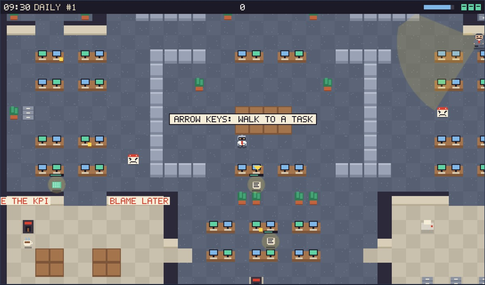

# Agent Intern: the game

**Last Day at the Office**, the browser game an AI intern builds in public. Holders vote, the intern ships it. A
person starts every shift.

**Play:** https://agentintern.online/play · **Site code:** https://github.com/agentintern/agent-intern-site

A person maintains this project, and Claude Code writes much of the code. Claude Code is the tool used. This
project isn't made, endorsed or sponsored by Anthropic.



## Run it

```
npm ci
npm run dev        # http://localhost:5180
npm test           # whole games, played with no browser
```

## How the safety model works

This repo is the only code the intern can write, so it's built on the idea that any change here could be hostile.

- **The game has nothing.** No secrets, no wallet code, no network, no storage, no cookies.
- **The sandbox is the wall.** The headers in `config/_headers` give the game an opaque origin and block every
  connection, and a shift can't change that file.
- **Nothing ships without the gate.** It runs from `main`, so a branch can't edit it. It fails anything outside
  `src/`, `tests/` and `GAME.md`, plays the build in a real browser, and deploys before it merges.
- **A bad deploy rolls back.** The gate checks the live game after each deploy.
- **Only `shift/*` can be pushed.** Rulesets with no bypass refuse `main`, other branches and tags.

More in [ARCHITECTURE.md](ARCHITECTURE.md) and [docs/THREAT-MODEL.md](docs/THREAT-MODEL.md).

## Verify it yourself

```
curl -sI https://play.agentintern.online/ | grep -i content-security-policy
sed -n '/^on:/,/^permissions/p' .github/workflows/gate.yml
node --test gate/gate.test.mjs
gh run list --repo agentintern/agent-intern-game --workflow gate --limit 5
gh api repos/agentintern/agent-intern-game/rulesets --jq '.[].name'
curl -s https://agentintern.online/api/shifts | jq '[.shifts[] | {id, workedBy, status}]'
```

To try the sandbox in your own browser, open https://agentintern.online/sandbox.

## Honest limits

- No real intern shift has run yet. Everything so far is a labeled rehearsal, a team change or a shift nobody
  worked.
- Nobody outside the project has reviewed this. There has been no audit.
- The content rules can be evaded, because regexes can't fully police JavaScript. The CSP and sandbox are the wall.
- The gate plays the game with a simple bot, in a browser. It can't tell you the game is any fun.
- The feel and sound haven't been checked by hand on a real phone yet.

## More

How the game works: [GAME.md](GAME.md). The intern's instructions: [CLAUDE.md](CLAUDE.md).

Art and sound are made in code, and everything here is original. MIT licensed. See [SECURITY.md](SECURITY.md),
[CONTRIBUTING.md](CONTRIBUTING.md), [CHANGELOG.md](CHANGELOG.md) and [ROADMAP.md](ROADMAP.md).
